# ExpenseFlow – Smart Personal Expense Tracker

**A full-stack expense management application built with React Native, Expo, Node.js, Express, and MongoDB.**

ExpenseFlow helps users track daily expenses, manage monthly budgets, monitor recurring payments, receive bill reminders, and understand their spending patterns through financial insights.

The project was built to explore full-stack mobile development, REST API design, authentication, database modelling, scheduled background jobs, and production deployment.

---

## 📱 Try ExpenseFlow

### Scan to download the Android APK

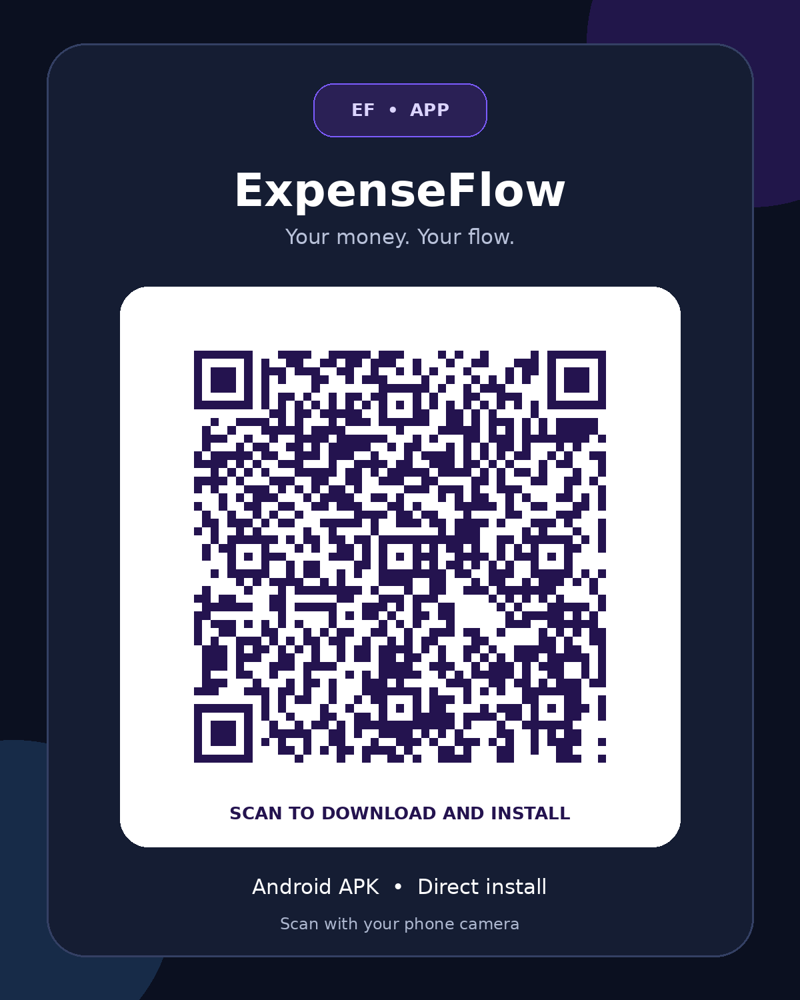

Scan the QR code using your phone to open the Android APK download link.

**Direct APK download:**  
[Download ExpenseFlow for Android](https://expo.dev/artifacts/eas/U9zpZTMT1f0PNCGZ2d4xfcNylwIAi0UYcUiUHlIBydw.apk)

> The APK is an Android application. Recruiters can scan the QR code using an Android phone to download and install it. They do not need to clone the repository to try the application.

### Project links

- **Source Code:** https://github.com/Ferozhasnain1504/expense-flow
- **Backend API:** https://expense-flow-5iv5.onrender.com
- **API Health Check:** https://expense-flow-5iv5.onrender.com/api/health
- **Android APK:** [Download here](https://expo.dev/artifacts/eas/U9zpZTMT1f0PNCGZ2d4xfcNylwIAi0UYcUiUHlIBydw.apk)

---

## ✨ Features

### 1. Authentication and User Management
- User registration and login.
- Password hashing using bcrypt.
- JWT-based authentication.
- Protected backend routes.
- Persistent login sessions using Expo Secure Store.
- Profile information and logout functionality.

### 2. Expense Management
- Add, edit, and delete expenses.
- Categorize expenses.
- View transaction history.
- Search expenses.
- Filter by date and category.
- Sort transactions.

### 3. Dashboard
- View expense summaries.
- Monitor recent transactions.
- Access important financial information from one screen.

### 4. Monthly Budget Management
- Set monthly budgets.
- Configure budgets for individual categories.
- Track spending against allocated budgets.
- View remaining budget.
- Monitor budget progress.

### 5. Recurring Expenses
- Create recurring payment schedules.
- Supported frequencies:
  - Daily
  - Weekly
  - Monthly
  - Yearly
- Pause and resume recurring expenses.
- Edit and delete recurring schedules.
- Automatically generate expense records when payments become due.

### 6. Bill Reminders and Notifications
- Schedule local notifications for recurring payments.
- Receive reminders one day before the scheduled due date.
- Manage notification scheduling when recurring expenses are created, updated, paused, resumed, or deleted.

### 7. Financial Insights
- Analyze daily spending trends.
- Compare spending with historical averages.
- Detect unusually large expenses using historical category data.
- Identify budget progress and overspending.
- Generate savings opportunities based on spending trends.
- Calculate a spending health score using available data.

**Note:** The financial insights engine currently uses rule-based logic and statistical calculations rather than an external AI/LLM service.

### 8. UI and Appearance
- Modern mobile interface.
- Dark and light themes.
- Theme persistence.
- Dedicated screens for dashboard, transactions, analytics, budgets, recurring expenses, and profile.

---

## 🛠️ Technology Stack

| Layer | Technologies |
|---|---|
| Mobile application | React Native, Expo |
| Navigation | React Navigation |
| Language | JavaScript |
| API communication | Axios |
| State management | React Context API |
| Local storage | AsyncStorage, Expo Secure Store |
| Backend | Node.js, Express.js |
| Database | MongoDB Atlas |
| ODM | Mongoose |
| Authentication | JWT, bcrypt |
| Scheduled jobs | node-cron |
| Notifications | expo-notifications |
| Charts | React Native charting library |
| Backend deployment | Render |
| Mobile builds | Expo Application Services (EAS) |
| Version control | Git, GitHub |

---

## 🏗️ System Architecture

ExpenseFlow follows a client-server architecture.

```text
              ANDROID APPLICATION
               React Native + Expo
                       |
                       |
                 React Navigation
                       |
                       |
                 React Context API
                       |
                       |
                  Axios Services
                       |
                 JWT Authorization
                       |
                       v
                 EXPRESS BACKEND
                       |
             Authentication Middleware
                       |
             Controllers and Routes
                       |
                       v
                 MONGOOSE ODM
                       |
                       v
                  MONGODB ATLAS
```

### Background Processing

```text
              Node-cron Scheduler
                       |
                       v
             Recurring Expense Job
                       |
              Check Due Expenses
                       |
                       v
              Create Expense Record
                       |
                       v
             Update Next Due Date
```

The mobile application communicates with the backend through REST APIs. Protected endpoints require a valid JWT access token.

---

## 🔄 How the Application Works

Consider a user adding a new expense.

1. The user enters an amount, category, date, and description.
2. The Add Expense screen calls the expense service.
3. Axios sends an HTTP request to the Express backend.
4. The authentication middleware validates the JWT.
5. The expense controller processes the request.
6. Mongoose stores the expense in MongoDB Atlas.
7. The backend returns the created expense.
8. The mobile application updates its expense state.
9. The updated information appears in the UI.

This separation keeps the mobile interface, API logic, business logic, and database operations organized.

---

## 📂 Project Structure

```text
ExpenseFlow/
│
├── backend/
│   ├── src/
│   │   ├── config/
│   │   │   └── db.js
│   │   ├── controllers/
│   │   ├── middleware/
│   │   ├── models/
│   │   ├── routes/
│   │   ├── jobs/
│   │   └── server.js
│   │
│   ├── package.json
│   └── .env.example
│
├── mobile/
│   ├── src/
│   │   ├── components/
│   │   ├── contexts/
│   │   ├── navigation/
│   │   ├── screens/
│   │   └── services/
│   │
│   ├── app.json
│   ├── eas.json
│   └── package.json
│
├── docs/
│   └── assets/
│       ├── expenseflow-qr.png
│       └── screenshots/
│
└── README.md
```

*The structure above shows the main application organization. Individual files may vary as the project evolves.*

---

## 🔐 Security and Authentication

ExpenseFlow implements:

- Password hashing using bcrypt before storing credentials.
- JWT-based authentication for protected API endpoints.
- Authentication middleware to validate incoming requests.
- Secure token storage using Expo Secure Store.
- Axios request interceptors to attach authentication tokens.
- Environment variables for sensitive backend configuration.

Database credentials and JWT secrets should never be committed to the repository.

---

## ⏰ Recurring Expense Processing

Recurring expenses are handled using a scheduled backend job.

The scheduler checks for active recurring expenses that are due. When a recurring payment becomes due, the backend:

1. Identifies the due recurring schedule.
2. Creates a normal expense record.
3. Associates the generated expense with its recurring schedule.
4. Updates the last processed date.
5. Calculates the next due date.

A unique occurrence key is used to help prevent duplicate expense generation for the same scheduled occurrence.

---

## 📊 Financial Insights Engine

The insights module processes a user's expense and budget data to generate useful observations.

It includes:

| Analysis | Purpose |
|---|---|
| Spending trends | Compare daily spending averages |
| Unusual expenses | Identify unusually high transactions |
| Budget analysis | Detect budget progress and overspending |
| Savings opportunities | Estimate potential spending reductions |
| Spending health score | Evaluate available financial indicators |

The score is calculated from available components. When historical data is insufficient, the application indicates that the score is partial instead of presenting missing information as a complete assessment.

---

## 🚀 Run Locally

### Prerequisites

- Node.js and npm
- MongoDB Atlas account or local MongoDB
- Expo Go on an Android device
- Git

### 1. Clone the repository

```bash
git clone YOUR_GITHUB_REPOSITORY_URL
cd ExpenseFlow
```

### 2. Set up the backend

```bash
cd backend
npm install
```

Create a `.env` file inside the backend directory:

```env
PORT=5000
MONGO_URI=your_mongodb_connection_string
JWT_SECRET=your_jwt_secret
```

Start the backend:

```bash
npm run dev
```

### 3. Set up the mobile application

Open a second terminal:

```bash
cd mobile
npm install
```

Start Expo:

```bash
npx expo start
```

Scan the Expo QR code using Expo Go on your Android device.

Make sure the mobile API configuration points to the backend address reachable from your device.

---

## 🌐 Deployment

| Component | Platform |
|---|---|
| Backend API | Render |
| Database | MongoDB Atlas |
| Android application | Expo EAS Build |

The backend is deployed on Render and connects to MongoDB Atlas.

The Android application is distributed as an APK generated through EAS Build.

---

## 🧠 Engineering Concepts Demonstrated

This project gave me practical experience with:

- Designing and consuming REST APIs.
- Building a mobile application using React Native and Expo.
- Implementing authentication and authorization using JWT.
- Managing application state using React Context API.
- Structuring backend code using routes, controllers, models, and middleware.
- Designing MongoDB schemas and relationships.
- Implementing scheduled background jobs.
- Handling recurring transactions and duplicate prevention.
- Implementing local notification scheduling.
- Building data-driven financial insights.
- Managing environment variables and deployment configuration.
- Using Git branches, commits, pull requests, and merges.

---

## 📸 Application Screenshots

## 📸 Application Screenshots

<table>
  <tr>
    <td align="center">
      <b>Login</b><br/>
      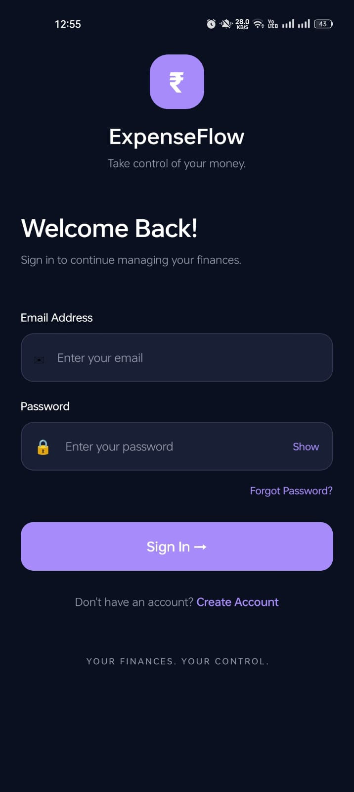
    </td>
    <td align="center">
      <b>Sign Up</b><br/>
      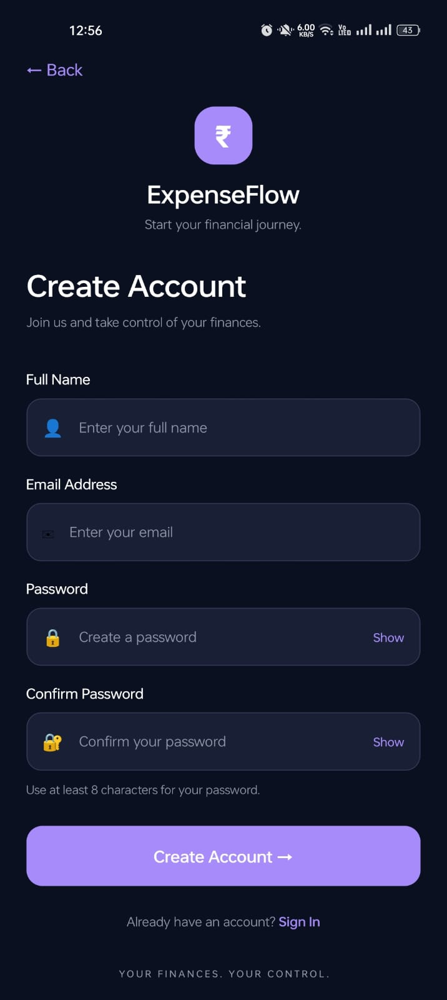
    </td>
  </tr>
  <tr>
    <td align="center">
      <b>Dashboard</b><br/>
      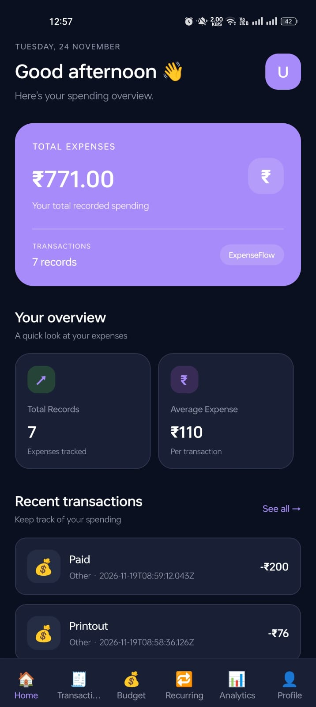
    </td>
    <td align="center">
      <b>Transactions</b><br/>
      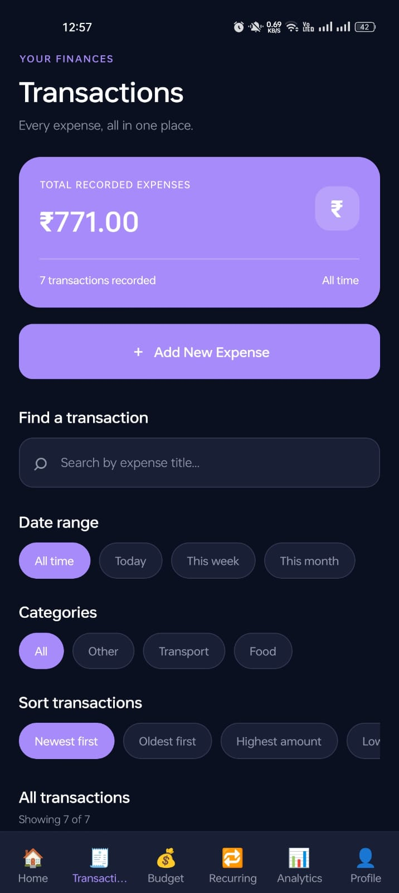
    </td>
  </tr>
  <tr>
    <td align="center">
      <b>Add Expense</b><br/>
      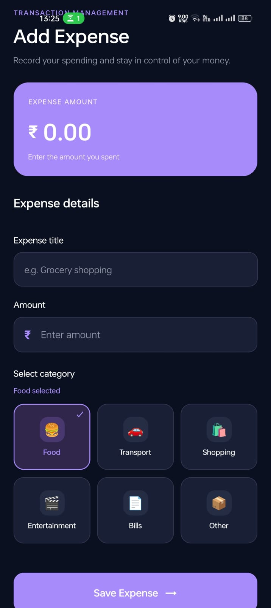
    </td>
    <td align="center">
      <b>Analytics</b><br/>
      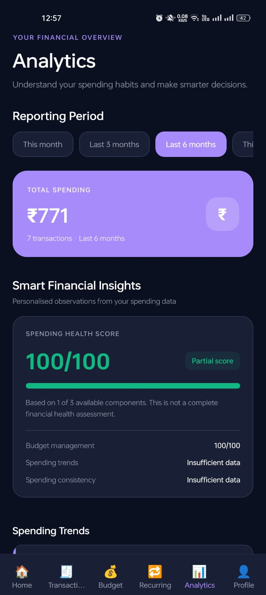
    </td>
  </tr>
  <tr>
    <td align="center">
      <b>Analytics – Category Breakdown</b><br/>
      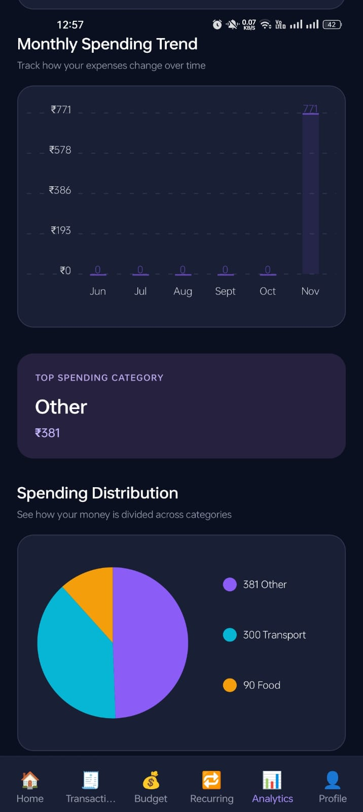
    </td>
    <td align="center">
      <b>Budget Management</b><br/>
      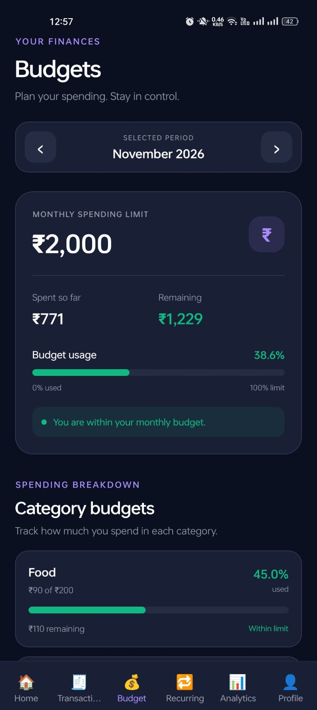
    </td>
  </tr>
  <tr>
    <td align="center">
      <b>Recurring Expenses</b><br/>
      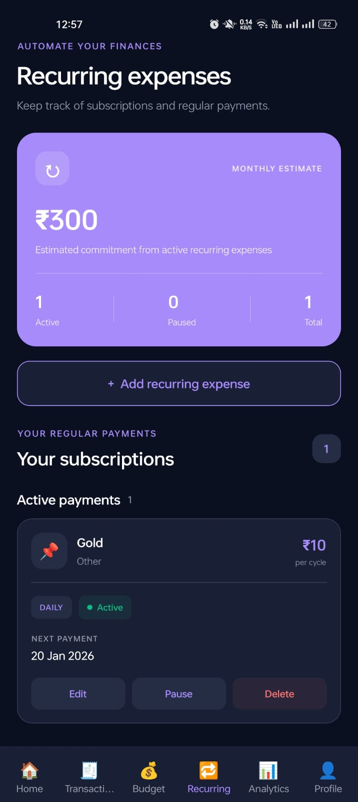
    </td>
    <td align="center">
      <b>Profile</b><br/>
      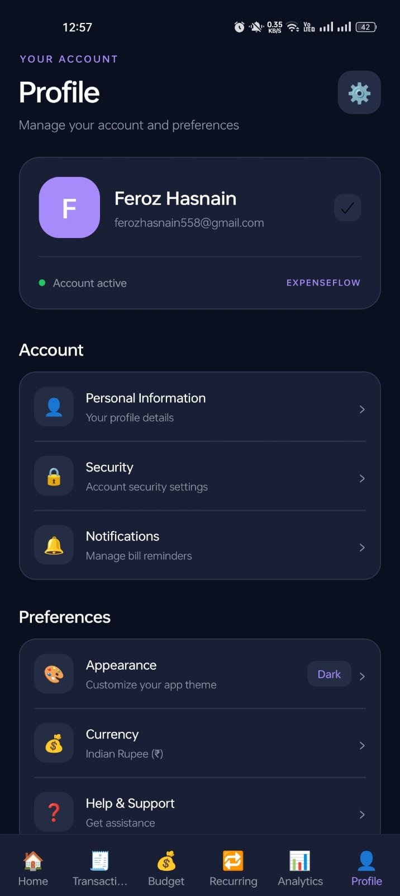
    </td>
  </tr>
</table>

---

## 🔮 Future Improvements

- Remote push notifications.
- Automated testing for mobile and backend.
- More advanced financial analytics.
- Export transactions to CSV or PDF.
- Receipt scanning and expense extraction.
- Multi-currency support.
- Improved recurring expense processing and monitoring.

---

## 👨‍💻 About the Project

ExpenseFlow is a full-stack mobile application developed to strengthen my understanding of software engineering beyond individual features.

My focus was on building an end-to-end product: from mobile UI and API integration to authentication, database operations, background processing, financial analysis, and deployment.

**The goal was not just to build screens, but to understand how a complete application works across multiple layers.**

If you are reviewing this project, I recommend exploring the source code, scanning the Android APK QR code, and checking the architecture and implementation details above.
